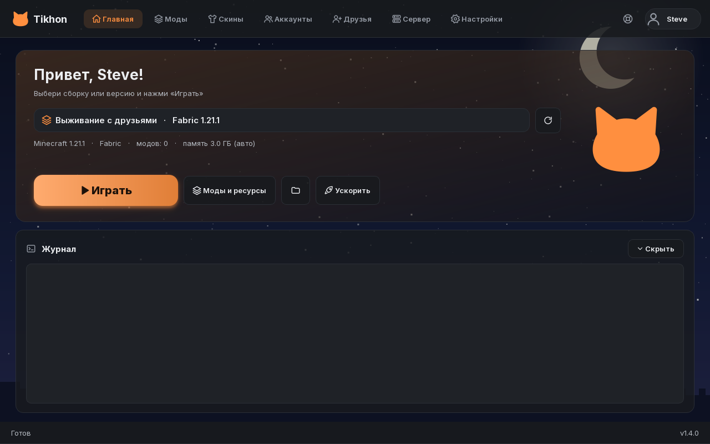
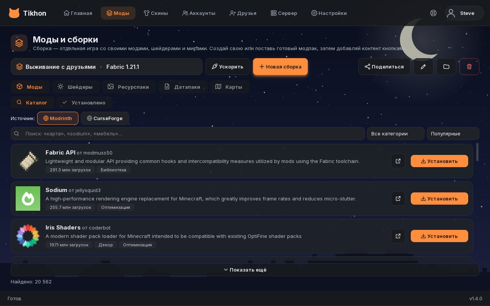
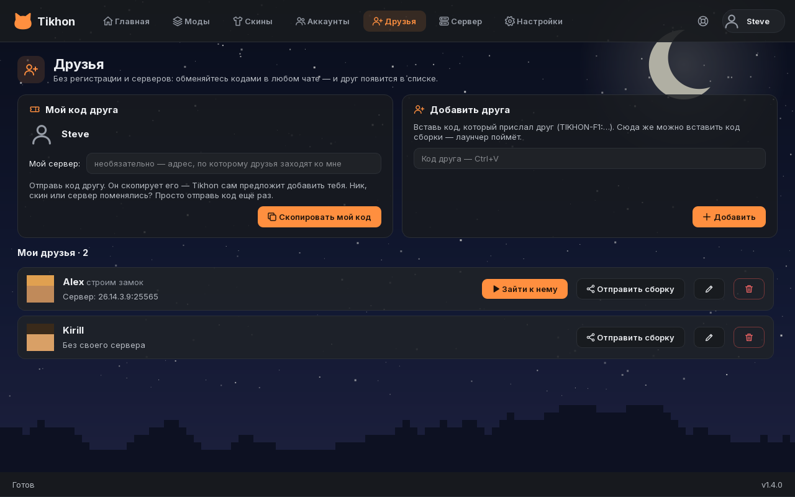
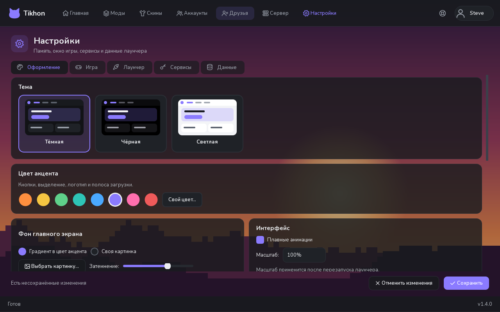
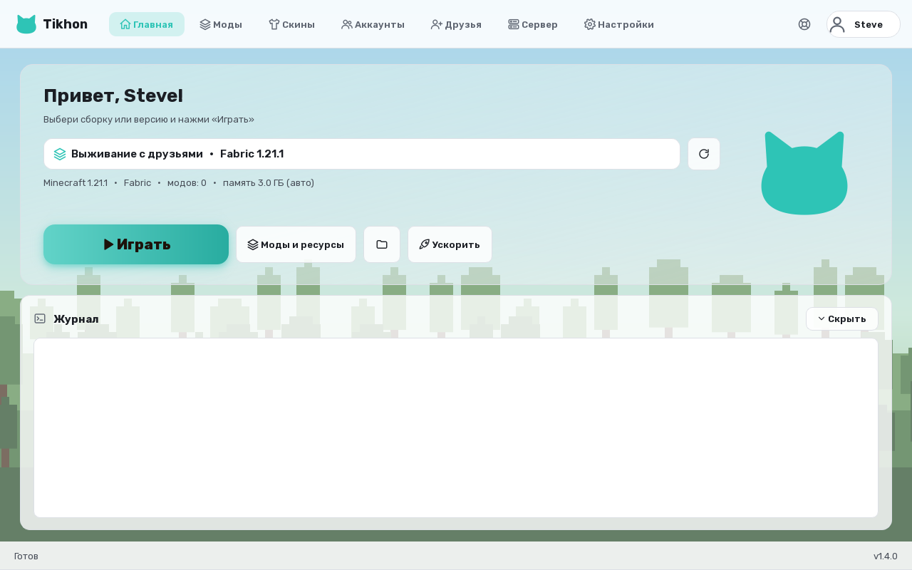

  

<h1 align="center">Tikhon</h1>

  <b>Бесплатный лаунчер Minecraft на русском: сборки с модами в пару кликов.</b> 
  Modrinth и CurseForge, шейдеры, скины, свой сервер и друзья по коду — в одном окне.

  <a href="https://github.com/vdvfdr-lab/tikhon/releases/latest/download/TikhonSetup.exe"><b>⬇ Скачать для Windows</b></a>
  &nbsp;·&nbsp;
  <a href="https://vdvfdr-lab.github.io/tikhon/">Сайт</a>
  &nbsp;·&nbsp;
  <a href="https://github.com/vdvfdr-lab/tikhon/releases">Все версии</a>

  
  
  

## Что умеет

- **Сборки с модами** — Fabric, NeoForge, Forge и Quilt ставятся сами; у каждой сборки свои моды, настройки и миры.
- **Каталог Modrinth и CurseForge** — моды, шейдеры, ресурспаки, датапаки и карты карточками с картинками, установка одной кнопкой, зависимости подтягиваются автоматически. Готовые модпаки и `.mrpack`.
- **Ускорение** — память под каждую сборку, оптимизированные настройки Java, моды-ускорители в один клик.
- **Друзья без регистрации** — обменяйтесь кодами в любом чате. Сборку можно отправить коротким кодом или файлом; скопированный код лаунчер замечает сам.
- **Свой сервер** — обычный или с модами вашей сборки, кнопкой; клиентские моды на сервер не попадают.
- **Аккаунты и скины** — вход через Microsoft, Ely.by или по нику; библиотека скинов.
- **Под себя** — тёмная, чёрная и светлая темы, любой цвет, обои на всё окно, шрифты с кириллицей.
- **Служба поддержки** — частые вопросы и отчёт об ошибке прямо из лаунчера.
- **Обновляется сам** и хранит всё в одной папке рядом с программой — официальный `.minecraft` не трогается.

| | |
|---|---|
|  |  |
|  |  |

## Установка

1. Скачай [**TikhonSetup.exe**](https://github.com/vdvfdr-lab/tikhon/releases/latest/download/TikhonSetup.exe)
   (или [портативную версию](https://github.com/vdvfdr-lab/tikhon/releases/latest/download/TikhonPortable.exe) — положи в любую папку и запусти, лаунчер докачается сам).
2. Если Windows покажет «Система Windows защитила ваш компьютер» — «Подробнее» → «Выполнить в любом случае»
   (так бывает с программами без платной подписи).
3. Введи ник, выбери оформление — и жми «Играть». Java и игру лаунчер скачает сам.

## Вопросы

**Это бесплатно?** Да. Игра скачивается с официальных серверов Mojang, моды — с Modrinth и CurseForge.

**Нужен ли купленный Minecraft?** Для входа через Microsoft и игры на официальных серверах — да
(Minecraft: Java Edition). Можно также войти через [Ely.by](https://ely.by) или играть по нику
в одиночной игре и на своём сервере.

**Нашёл ошибку?** Кнопка со спасательным кругом в лаунчере → «Сообщить о проблеме», или
[создай issue](https://github.com/vdvfdr-lab/tikhon/issues).

---

Счётчик скачиваний честный: считаются только установщик и портативная версия — то, что качают
люди. Проверки и загрузки обновлений самими лаунчерами в него не входят.

Не является официальным продуктом Minecraft. Не одобрено и не связано с Mojang или Microsoft.
Шрифты в лаунчере — под лицензией SIL Open Font License.
